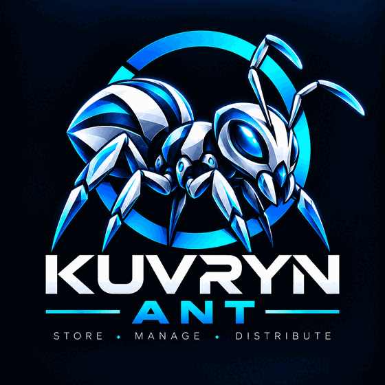

<p align="center">
  
</p>

<h1 align="center">Kuvryn Ant</h1>

<p align="center">
  <strong>A self-hosted artifact repository and caching proxy for 26 package formats.</strong><br>
  One artifact core, many protocol adapters. PostgreSQL metadata, disk or S3 storage.
</p>

<p align="center">
  <a href="https://github.com/azrtydxb/Kuvryn-Ant/actions/workflows/ci.yml"></a>
  <a href="https://github.com/azrtydxb/Kuvryn-Ant/actions/workflows/pages.yml"></a>
  <a href="https://scorecard.dev/viewer/?uri=github.com/azrtydxb/Kuvryn-Ant"></a>
  <a href="LICENSE"></a>
  <a href="go.mod"></a>
  <a href="https://goreportcard.com/report/github.com/azrtydxb/Kuvryn-Ant"></a>
  <a href="https://github.com/azrtydxb/Kuvryn-Ant/releases"></a>
</p>

<p align="center">
  <a href="https://azrtydxb.github.io/Kuvryn-Ant/"><strong>Documentation</strong></a> ·
  <a href="https://azrtydxb.github.io/Kuvryn-Ant/guide/quick-start">Quick start</a> ·
  <a href="https://azrtydxb.github.io/Kuvryn-Ant/formats/">Formats</a> ·
  <a href="https://azrtydxb.github.io/Kuvryn-Ant/reference/api">API</a> ·
  <a href="CONTRIBUTING.md">Contributing</a>
</p>


Kuvryn Ant hosts your own packages and caches public registries behind stable,
per-format endpoints called **feeds**. Each feed reads from an ordered list of
**sources** (local, remote pull-through, or replicated from another site) and
publishes to exactly one local source. Every format adapter translates its
ecosystem's protocol onto the same artifact core, so publication, resolution,
policies, audit, retention and replication behave identically for Docker images,
npm packages, Python wheels or Hugging Face models.

> **Status:** pre-release (0.1.0). All 26 formats are implemented and most are exercised by
> real-client conformance tests (see the per-format gaps), but no tagged release or
> published container image exists yet; build the image from this repository. See the
> [roadmap](ROADMAP.md).

## Features

- **26 package formats:** OCI/Docker, Helm, npm, PyPI, Maven, Go modules and sumdb,
  Cargo, NuGet, RubyGems, Composer, Conda, Conan, CRAN, pub, CocoaPods, Swift,
  Terraform, Ansible Galaxy, APT, RPM, APK, Git LFS, P2, Hugging Face and raw files
  over WebDAV.
- **Pull-through caching that fails safe:** the owner of a package wins, a remote
  404 falls through, a remote error stops the search. Cached metadata is served
  stale (and marked) while an upstream is down. Credentials are encrypted per source
  and only ever sent to that source's origin.
- **Host-level mirrors:** serve containerd, CRI-O, Docker, Podman and BuildKit as a
  registry mirror, with a mirror mode for unprefixed paths.
- **Build caches:** evictable `cache` feeds for buildx registry caches and sccache
  over WebDAV, with idle and size limits, tag-overwrite release and branch cleanup.
- **Identity:** local users with TOTP, OIDC, SAML and LDAP sign-in, persisted roles
  and grants, scoped service tokens, personal access tokens, and GitHub Actions OIDC
  exchange for short-lived CI credentials.
- **Replication and federation:** gapless, digest-verified replication between
  sites, plus federation with signed membership, shared policy, placement-aware
  routing and authority handover.
- **Operations:** atomic audited publication, two-phase garbage collection,
  storage-pressure eviction, quotas, integrity scans, backup and restore, Nexus
  migration, prewarm jobs, webhooks, Prometheus metrics and OpenTelemetry tracing.
- **Interfaces:** a React console embedded in the binary, a versioned management API
  (`/api/v1`, OpenAPI contract) and an MCP endpoint that calls the same handlers.

## Quick start

Requirements: Docker with Compose and OpenSSL.

```sh
git clone https://github.com/azrtydxb/Kuvryn-Ant.git && cd Kuvryn-Ant
scripts/init-dev.sh                                   # generates .local/ secrets
docker compose --profile app up --build -d            # PostgreSQL + Kuvryn Ant
docker compose --profile app exec app ant-entrypoint bootstrap   # prints an admin token once
docker compose --profile app restart app
```

Open <http://127.0.0.1:8080/console/> and sign in with the token. For Kubernetes
(Helm), a plain binary, and a first pull-through feed, follow the
[quick start guide](https://azrtydxb.github.io/Kuvryn-Ant/guide/quick-start).

## Supported formats

| Format                   | Feed endpoint                       | Publish                               | Remote cache              | Guide                                                                        |
| ------------------------ | ----------------------------------- | ------------------------------------- | ------------------------- | ---------------------------------------------------------------------------- |
| OCI / Docker             | `/v2/<feed>/<repo>`                 | native (`docker push`, buildx, crane) | verified                  | [OCI](https://azrtydxb.github.io/Kuvryn-Ant/formats/oci)                     |
| OCI artifacts            | `/v2/<feed>/<repo>`                 | native (`oras push`)                  | verified                  | [OCI](https://azrtydxb.github.io/Kuvryn-Ant/formats/oci#oci-artifacts-feeds) |
| Helm (classic and OCI)   | `/feeds/<feed>/helm/`               | upload API; `helm push oci://`        | verified                  | [Helm](https://azrtydxb.github.io/Kuvryn-Ant/formats/helm)                   |
| npm / pnpm / Yarn        | `/feeds/<feed>/npm/`                | native                                | verified                  | [npm](https://azrtydxb.github.io/Kuvryn-Ant/formats/npm)                     |
| PyPI (pip / uv / Poetry) | `/feeds/<feed>/pypi/simple/`        | native (`twine upload`)               | verified                  | [PyPI](https://azrtydxb.github.io/Kuvryn-Ant/formats/pypi)                   |
| Maven / Gradle           | `/feeds/<feed>/maven/`              | native (`mvn deploy`)                 | verified                  | [Maven](https://azrtydxb.github.io/Kuvryn-Ant/formats/maven)                 |
| Go modules and sumdb     | `/feeds/<feed>/go`                  | upload API                            | verified                  | [Go](https://azrtydxb.github.io/Kuvryn-Ant/formats/go)                       |
| Cargo                    | `/feeds/<feed>/cargo/`              | native                                | verified                  | [Cargo](https://azrtydxb.github.io/Kuvryn-Ant/formats/cargo)                 |
| NuGet                    | `/feeds/<feed>/nuget/v3/index.json` | native (see guide)                    | verified                  | [NuGet](https://azrtydxb.github.io/Kuvryn-Ant/formats/nuget)                 |
| RubyGems                 | `/feeds/<feed>/rubygems/`           | native                                | verified                  | [RubyGems](https://azrtydxb.github.io/Kuvryn-Ant/formats/rubygems)           |
| Composer                 | `/feeds/<feed>/composer/`           | upload API                            | verified                  | [Composer](https://azrtydxb.github.io/Kuvryn-Ant/formats/composer)           |
| Conda                    | `/feeds/<feed>/conda/`              | upload API                            | verified (small channels) | [Conda](https://azrtydxb.github.io/Kuvryn-Ant/formats/conda)                 |
| Conan                    | `/feeds/<feed>/conan/`              | native                                | verified                  | [Conan](https://azrtydxb.github.io/Kuvryn-Ant/formats/conan)                 |
| CRAN                     | `/feeds/<feed>/cran/`               | upload API                            | verified                  | [CRAN](https://azrtydxb.github.io/Kuvryn-Ant/formats/cran)                   |
| pub (Dart / Flutter)     | `/feeds/<feed>/pub/`                | native                                | verified                  | [pub](https://azrtydxb.github.io/Kuvryn-Ant/formats/pub)                     |
| CocoaPods                | `/feeds/<feed>/cocoapods/`          | upload API                            | implemented               | [CocoaPods](https://azrtydxb.github.io/Kuvryn-Ant/formats/cocoapods)         |
| Swift packages           | `/feeds/<feed>/swift/`              | upload API                            | implemented               | [Swift](https://azrtydxb.github.io/Kuvryn-Ant/formats/swift)                 |
| Terraform / OpenTofu     | `/feeds/<feed>/terraform/`          | upload API                            | implemented               | [Terraform](https://azrtydxb.github.io/Kuvryn-Ant/formats/terraform)         |
| Ansible Galaxy           | `/feeds/<feed>/ansible/`            | upload API                            | implemented               | [Ansible](https://azrtydxb.github.io/Kuvryn-Ant/formats/ansible)             |
| APT (Debian / Ubuntu)    | `/feeds/<feed>/apt/`                | upload API                            | verified                  | [APT](https://azrtydxb.github.io/Kuvryn-Ant/formats/apt)                     |
| RPM (DNF / YUM)          | `/feeds/<feed>/rpm/`                | upload API                            | verified                  | [RPM](https://azrtydxb.github.io/Kuvryn-Ant/formats/rpm)                     |
| APK (Alpine)             | `/feeds/<feed>/apk/`                | upload API                            | implemented               | [APK](https://azrtydxb.github.io/Kuvryn-Ant/formats/apk)                     |
| Git LFS                  | `/feeds/<feed>/git-lfs/`            | native (`git lfs push`)               | implemented               | [Git LFS](https://azrtydxb.github.io/Kuvryn-Ant/formats/git-lfs)             |
| P2 (Eclipse)             | `/feeds/<feed>/p2/`                 | upload API                            | implemented               | [P2](https://azrtydxb.github.io/Kuvryn-Ant/formats/p2)                       |
| Hugging Face             | `/feeds/<feed>/huggingface/`        | upload API                            | verified                  | [Hugging Face](https://azrtydxb.github.io/Kuvryn-Ant/formats/huggingface)    |
| Raw / WebDAV (sccache)   | `/feeds/<feed>/raw/`                | native (HTTP `PUT`, WebDAV)           | verified                  | [Raw](https://azrtydxb.github.io/Kuvryn-Ant/formats/raw)                     |

_Verified_: a real client pulled through a public upstream in the conformance run.
_Implemented_: the pull-through code exists but no real-client run has passed yet.
_Upload API_: the ecosystem has no native publish command Ant supports, so packages
are uploaded with an HTTP call. Each guide lists the tested clients, limits and
known gaps.

Every format can also be served from a read-only replica source fed by
[replication](https://azrtydxb.github.io/Kuvryn-Ant/replication/).

## Architecture

```text
 clients (docker, npm, pip, mvn, go, cargo, helm, ...)      console · /api/v1 · /mcp
                     │                                              │
          protocol adapters (internal/<format>)          management (internal/management)
                     └──────────────┬───────────────────────────────┘
                     artifact core (internal/artifact): publish, resolve, policies, delete
                     │                         │                              │
            PostgreSQL metadata     blob storage (disk / S3)     remote runtime → upstreams
                                                                 replication / federation peers
```

Read the [introduction](https://azrtydxb.github.io/Kuvryn-Ant/guide/introduction)
for feeds, sources, read order and publish policies.

## Building from source

```sh
go build ./cmd/ant                         # server and CLI (Go 1.27)
docker build -t kuvryn-ant:dev .           # container image with the embedded console
helm lint deploy/chart                     # Helm chart
```

See [CONTRIBUTING.md](CONTRIBUTING.md) for the development setup, tests and
conventions.

## Contributing

Contributions are welcome: bug reports, format support requests, documentation and
code. Read [CONTRIBUTING.md](CONTRIBUTING.md) and the
[Code of Conduct](CODE_OF_CONDUCT.md). Commits are signed off (`git commit -s`)
under the Developer Certificate of Origin. For help, see [SUPPORT.md](SUPPORT.md).

## Security

Please report vulnerabilities privately through
[GitHub private vulnerability reporting](https://github.com/azrtydxb/Kuvryn-Ant/security/advisories/new).
See [SECURITY.md](SECURITY.md) and the
[security model](https://azrtydxb.github.io/Kuvryn-Ant/about/security).

## License

Kuvryn Ant is licensed under the [Apache License 2.0](LICENSE).
Copyright 2026 The Kuvryn Ant Authors. See [NOTICE](NOTICE).
