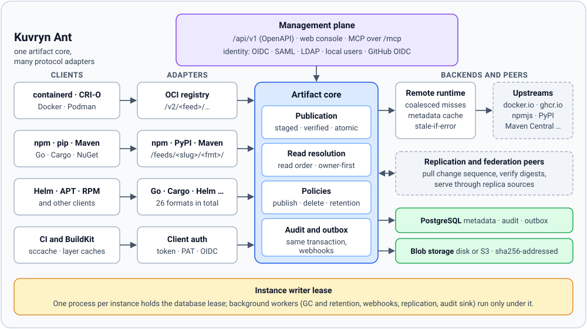

# Introduction

Kuvryn Ant is a self-hosted artifact repository and caching proxy. One Go service serves 26 package formats, publishes your own artifacts, caches public registries (pull-through), and replicates feeds between independent instances. Metadata lives in PostgreSQL. Content lives as content-addressed blobs on local disk or S3-compatible storage.

This page covers what Ant does and how its parts fit together. The [quick start](quick-start.md) gets an instance running. The [concepts](../concepts/feeds-and-sources.md) section explains the resource model in detail.

## Features

| Area                       | What Ant provides                                                                                                                                                                                                                                                                                                                                            |
| -------------------------- | ------------------------------------------------------------------------------------------------------------------------------------------------------------------------------------------------------------------------------------------------------------------------------------------------------------------------------------------------------------ |
| Formats                    | 26 formats behind one core: OCI (Docker images and OCI artifacts), Helm, npm, PyPI, Maven, Go modules, Cargo, NuGet, RubyGems, Composer, Conda, Conan, CRAN, pub, CocoaPods, Swift, Terraform, Ansible Galaxy, APT, RPM, APK, Git LFS, P2, Hugging Face and Raw (with WebDAV). See the [format overview](../formats/index.md).                               |
| Pull-through caching       | Remote sources proxy an upstream registry. Immutable artifacts are cached on first download and verified against the upstream digest where the format publishes one. Mutable metadata (indexes, tags) goes through a bounded metadata cache with TTL, negative caching and stale-if-error. Concurrent misses for the same object share one upstream request. |
| Publishing                 | Local sources accept uploads through each ecosystem's own publish protocol. Content is staged, digest-verified and committed atomically together with its audit record. [Publish policies](../concepts/publish-policies.md) route each write to exactly one local source.                                                                                    |
| Host-level caching         | Ant can act as a registry mirror for containerd, CRI-O, Docker, Podman and BuildKit. See [host-level caching](../host-caching/index.md).                                                                                                                                                                                                                     |
| Replication and federation | One instance pulls a feed's change sequence from another, verifies every blob and serves the result through a read-only replica source. Federation groups instances so that reads which miss locally can be routed to another member. See [replication](../replication/index.md) and [federation](../replication/federation.md).                             |
| Identity and access        | Browser sign-in with OIDC, SAML 2.0, LDAP/Active Directory or local accounts. A separate break-glass account is available. Persisted roles and grants with explicit deny. Service accounts with scoped tokens, personal access tokens, and GitHub Actions OIDC token exchange. See [identity](../identity/index.md).                                         |
| Retention and storage      | Two-phase mark-and-sweep garbage collection (blobs are never deleted inline), retention policies, an instance default policy, storage-pressure eviction and integrity scans. See [storage maintenance](../operations/storage-maintenance.md).                                                                                                                |
| Build caches               | Feeds with `purpose: cache` hold BuildKit registry layer caches (OCI) and sccache entries over WebDAV (Raw). They are evicted by idle time and size, and they are never replicated. See [build caches](../build-caches/index.md).                                                                                                                            |
| Prewarm                    | Durable jobs that fill a feed's remote cache from package lists, lockfiles, image lists or another feed before builds ask for it. See [prewarm](../operations/prewarm.md).                                                                                                                                                                                   |
| Migration                  | Import and export, plus `ant migrate nexus` to move repositories and content from Nexus 3. See [import, export and Nexus migration](../operations/import-export.md).                                                                                                                                                                                         |
| Management API             | `/api/v1`, described by an OpenAPI contract. It uses cursor pagination, structured errors, `If-Match` revisions and `Idempotency-Key` on mutations. See the [API reference](../reference/api.md).                                                                                                                                                            |
| MCP                        | A Model Context Protocol endpoint at `/mcp` calls the same management handlers in process, so authorization and audit are identical to the API. See [MCP tools](../reference/mcp.md).                                                                                                                                                                        |
| Audit and webhooks         | Every successful mutation is audited in the same database transaction as the change and its outbox event. Webhooks are delivered from that outbox. An audit sink can forward records to an external system.                                                                                                                                                  |
| Console                    | A React web console at `/console/`, embedded in the binary. See the [console tour](../console/tour.md).                                                                                                                                                                                                                                                      |

## Architecture

### One artifact core, many protocol adapters

All artifact behaviour lives in one core package (`internal/artifact`):

- publication: staged, digest-verified upload and an atomic commit of components, versions, assets and tags, with audit and outbox records in the same transaction
- read resolution across a feed's sources
- publish, delete and retention policies
- deletes
- the pull-through seam to remote sources

Each format adapter (`internal/<format>`) only translates its ecosystem's protocol onto that core. For example, the npm adapter parses packuments and tarball paths, and the OCI adapter implements the distribution API. An adapter never writes storage directly. All adapters are constructed and mounted in [`cmd/ant/artifacts.go`](https://github.com/azrtydxb/Kuvryn-Ant/blob/main/cmd/ant/artifacts.go):

| Protocol        | Endpoint                                                                                                              |
| --------------- | --------------------------------------------------------------------------------------------------------------------- |
| OCI             | `https://ant.example.com/v2/<feed>/<repository>/...` (image refs look like `ant.example.com/<feed>/<repo>:<tag>`)     |
| Everything else | `https://ant.example.com/feeds/<slug>/<format-path>/...`, for example `/feeds/npm/npm/` or `/feeds/pypi/pypi/simple/` |

Because every adapter uses the same core, the following work identically for every format:

- authorization
- audit
- quotas
- retention
- replication
- the [resolve explanation](../concepts/resolution.md)

### Feeds, sources and policies

A **feed** is the stable endpoint that clients use for one format. A feed has an ordered list of **sources**:

| Source kind | Role                                                                                                                             |
| ----------- | -------------------------------------------------------------------------------------------------------------------------------- |
| `local`     | Holds artifacts published to Ant. The only kind that accepts writes.                                                             |
| `remote`    | Proxies one upstream origin (for example `https://registry.npmjs.org`). Artifacts are cached under the source on first download. |
| `replica`   | Read-only. Filled by a replication job from a peer instance.                                                                     |

The feed's **read order** decides which source answers. The first source that contains a package owns every version of it. Package names that no source holds fall through to remote sources in order. An upstream error stops the search instead of falling through, so an outage of a private upstream can never resolve a private name from a public one. See [read order and resolve explain](../concepts/resolution.md).

The feed's **publish policy** resolves every write to exactly one local source. Writes never go upstream. See [publish policies](../concepts/publish-policies.md).

### Purpose: artifacts or cache

Every feed has a [purpose](../concepts/purposes.md):

- `artifacts` (the default) is ordinary published and cached content.
- `cache` is for CI build caches. It is limited to the OCI and Raw formats. Cache feeds are evicted by idle time, size and storage pressure without needing `allow_release_delete`, are never replicated, and are hidden from package search by default.

### Storage

- **Metadata** lives in PostgreSQL only. This covers feeds, sources, components, versions, assets, tags, principals, grants, audit, outbox, jobs and replication checkpoints. Startup applies numbered migrations under an advisory lock.
- **Blobs** are content-addressed by SHA-256. They are stored on a local disk backend or an S3-compatible backend (`internal/blob`, `internal/storage`), and online migration between disk and S3 is supported. Identical content is stored once per deduplication domain. Blobs are never deleted inline. Garbage collection marks unreferenced blobs and sweeps them after a grace period, re-checking references under a row lock before deleting.

See [blob storage](../install/storage.md) and [PostgreSQL](../install/postgresql.md).

### Remote fetching

Pull-through is layered:

| Layer                | Package                  | Responsibility                                                                                                 |
| -------------------- | ------------------------ | -------------------------------------------------------------------------------------------------------------- |
| Remote configuration | `internal/remoteconfig`  | Normalized origin, redirect origins and cache policy. Credentials are encrypted per source and never returned. |
| Runtime              | `internal/remoteruntime` | Coalesced misses, metadata and negative cache, stale-if-error, source health.                                  |
| Fetcher              | `internal/upstream`      | HTTP client, bearer-token handshake for OCI registries, origin-checked redirects, a circuit breaker.           |

A credential is only ever sent to its source's origin, or to a token realm that is the origin or one of the configured redirect origins. Only `GET` is sent upstream. The one exception is the bounded Git LFS batch query.

### Single writer lease

Each process holds a database writer lease for its instance (`internal/ownership`). A second process with the same instance identity cannot become writable. Background workers run only under that lease: webhooks, garbage collection and retention, replication, and audit purge and sink. Scale reads across sites with [replication](../replication/index.md), not with multiple writable pods sharing one instance.

### Management plane

`internal/management` serves `/api/v1`, using the contract in [`api/openapi.yaml`](https://github.com/azrtydxb/Kuvryn-Ant/blob/main/api/openapi.yaml). The console and the MCP endpoint both use the same handlers. Identity (`internal/identity`) provides principals, roles, scoped tokens and the client-authentication middleware that wraps every `/feeds/...` and `/v2/...` route. Browser login is provided by `internal/oidclogin`, `internal/samllogin` and `internal/directory`.

## Next steps

- [Quick start](quick-start.md)
- [Feeds and sources](../concepts/feeds-and-sources.md)
- [Helm chart installation](../install/helm.md)
- [Host-level caching for container runtimes](../host-caching/index.md)
